# PRAKTIKUM 7 – PEMROGRAMAN SERVER-SIDE PHP

## 1. Deskripsi Praktikum

Praktikum 7 membahas pemrograman server-side menggunakan bahasa PHP. Praktikum ini bertujuan untuk memahami dasar-dasar PHP, penggunaan variabel, operator, percabangan, perulangan, array, function, serta pengolahan data menggunakan form HTML dengan metode GET dan POST.

Selain itu, praktikum ini juga mempelajari validasi input pengguna dan penerapan PHP dalam pembuatan aplikasi sederhana.

## 2. Tujuan Praktikum

- Memahami konsep dasar pemrograman server-side menggunakan PHP.
- Mengenal sintaks, variabel, dan tipe data PHP.
- Menggunakan percabangan dan perulangan.
- Mengolah data menggunakan array dan function.
- Memahami penggunaan metode GET dan POST.
- Menerapkan validasi input pada form.
- Membuat aplikasi sederhana menggunakan PHP.

## 3. Perangkat yang Digunakan

Perangkat lunak yang digunakan dalam praktikum:

- XAMPP sebagai web server lokal.
- Apache sebagai web server.
- Visual Studio Code sebagai editor kode.
- Web Browser untuk menjalankan dan menguji program.
- PHP sebagai bahasa pemrograman server-side.

## 4. Cara Menjalankan Program

Berikut langkah-langkah menjalankan program:

1. Membuka aplikasi XAMPP.
2. Mengaktifkan Apache melalui tombol Start.
3. Memastikan folder proyek berada di dalam direktori `htdocs`.
4. Membuka Visual Studio Code.
5. Membuka folder `Lab7Web_PHP`.
6. Membuka browser.
7. Menjalankan program melalui alamat berikut:

   `http://localhost/Lab7Web_PHP/`

Setiap file PHP dapat dijalankan dengan menambahkan nama file pada alamat localhost.

Contoh:

`http://localhost/Lab7Web_PHP/mini_project.php`

## 5. Struktur Folder Proyek

```text
Lab7Web_PHP/
│
├── index.php
├── cari.php
├── latihan2.php
├── latihan3.php
├── latihan4.php
├── latihan6.php
├── latihan7.php
│
├── mini_project.php
│
├── eksperimen1.php
├── eksperimen2.php
├── eksperimen3.php
├── eksperimen4.php
├── eksperimen5.php
│
├── screenshots/
│   ├── Latihan1_Menjalankan_PHP.png
│   ├── Latihan2_Variabel_Percabangan.png
│   ├── Latihan3_Perulangan_Array.png
│   ├── Latihan4_Function.png
│   ├── Latihan5_Form_GET.png
│   ├── Latihan6_Form_POST.png
│   ├── Latihan7_Pengolahan_Data.png
│   ├── MiniProject_Form.png
│   ├── MiniProject_Hasil_Error.png
│   ├── MiniProject_Hasil_Valid.png
│   ├── Eksperimen1_Nilai_Rata_Rata.png
│   ├── Eksperimen2_Pencarian_GET.png
│   ├── Eksperimen3_Format_Rupiah.png
│   ├── Eksperimen4_NIM_Invalid.png
│   ├── Eksperimen4_NIM_Valid.png
│   ├── Eksperimen5_Hasil_Kirim.png
│   └── Eksperimen5_Hasil_Reset.png
│
└── README.md
```

## 6. Ringkasan Kegiatan Praktikum

### A. Latihan Dasar PHP

Kegiatan latihan meliputi:

- Menjalankan program PHP melalui localhost.
- Menampilkan data mahasiswa dan nilai akhir.
- Menampilkan daftar mahasiswa menggunakan array.
- Menghitung diskon dan luas persegi panjang.
- Membuat form pencarian menggunakan GET.
- Membuat form input data mahasiswa.
- Membuat form transaksi barang dan menghitung subtotal.

### B. Mini Project – Formulir Data Mahasiswa

Mini Project merupakan aplikasi sederhana untuk memasukkan dan memvalidasi data mahasiswa.

Data yang digunakan meliputi:

- Nama lengkap.
- NIM.
- Program studi.
- Semester.
- Email.

Validasi dilakukan menggunakan PHP untuk memastikan data yang dimasukkan sesuai ketentuan.

### C. Eksperimen Mandiri

Eksperimen yang telah dikerjakan:

1. Menghitung nilai rata-rata dari tiga komponen nilai.
2. Membuat pencarian nama mahasiswa menggunakan metode GET dan array.
3. Membuat function untuk memformat harga ke dalam Rupiah.
4. Membuat validasi NIM agar hanya berisi angka dan memiliki panjang 10 digit.
5. Menambahkan tombol Reset pada form dan memahami perbedaannya dengan pemrosesan server.

## 7. Hasil Pengujian

### A. Pengujian Mini Project

**Pengujian data valid:**

| Kolom | Data |
|---|---|
| Nama | Kensha Dara |
| NIM | 123456789 |
| Program Studi | Teknik Informatika |
| Semester | 3 |
| Email | kensha@gmail.com |

Hasil: Data mahasiswa berhasil diterima dan ditampilkan.

**Pengujian data tidak valid:**

| Kolom | Data |
|---|---|
| Nama | Kosong |
| NIM | 123456789 |
| Program Studi | Teknik Informatika |
| Semester | 15 |
| Email | kensha123 |

Hasil: PHP menampilkan pesan kesalahan karena nama wajib diisi, format email tidak valid, dan semester harus berada pada rentang 1–14.

### B. Pengujian Eksperimen

- Eksperimen 1: Nilai rata-rata berhasil dihitung sebesar 85.00.
- Eksperimen 2: Pencarian nama berhasil dijalankan menggunakan GET.
- Eksperimen 3: Format Rupiah berhasil ditampilkan.
- Eksperimen 4: Validasi NIM berhasil memeriksa angka dan panjang karakter.
- Eksperimen 5: Tombol Kirim Data dan Reset berhasil diuji.

## 8. Dokumentasi Screenshot

Dokumentasi screenshot berikut merupakan bukti pelaksanaan dan hasil pengujian Praktikum 7 – Pemrograman Server-Side PHP.

### A. Latihan Dasar PHP

**Latihan 1 – Menjalankan PHP**

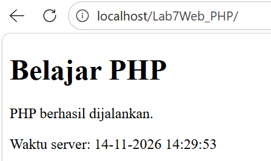

**Latihan 2 – Variabel dan Percabangan**

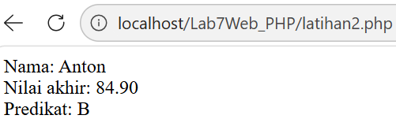

**Latihan 3 – Perulangan dan Array**

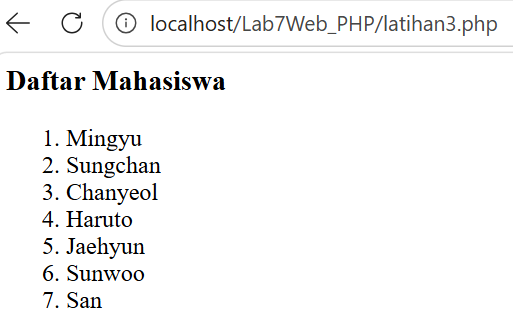

**Latihan 4 – Function**

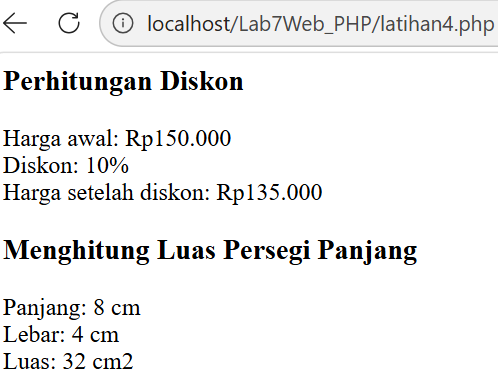

**Latihan 5 – Form GET**

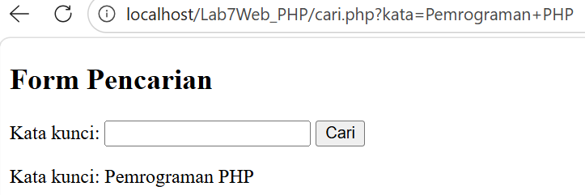

**Latihan 6 – Form POST**

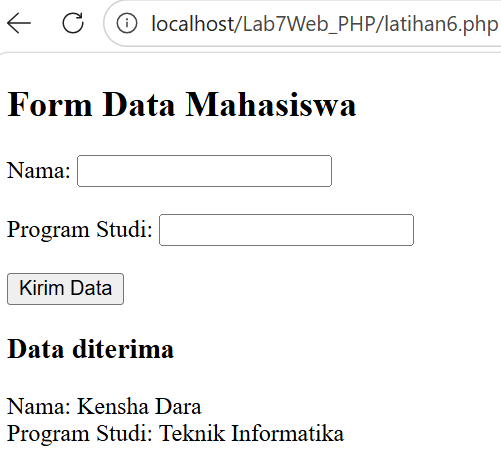

**Latihan 7 – Pengolahan Data**

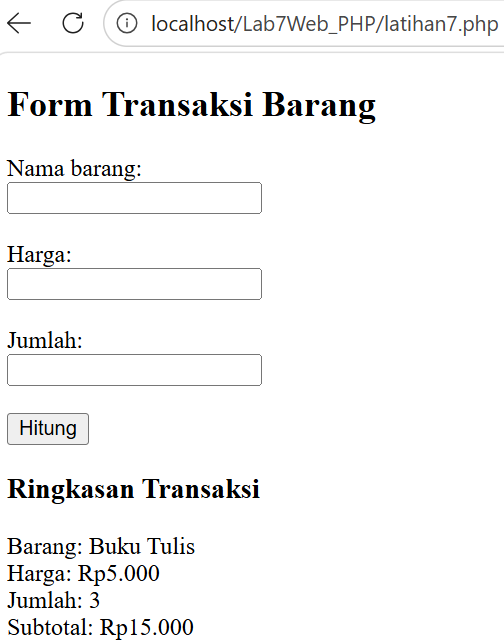

### B. Mini Project – Formulir Data Mahasiswa

**Tampilan Formulir**

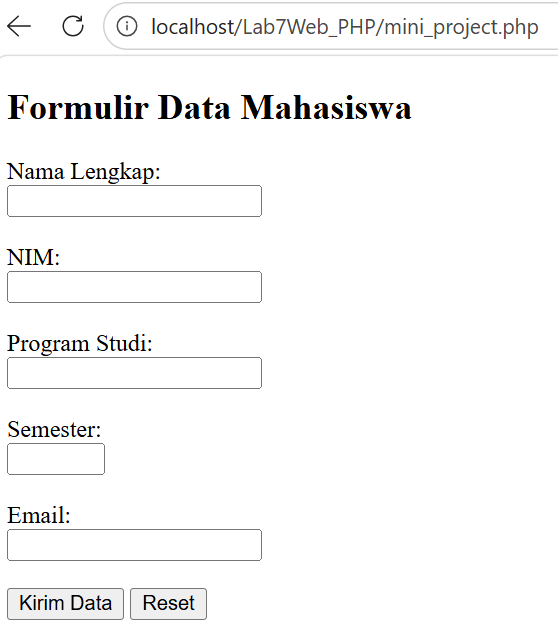

**Hasil Pengujian Data Tidak Valid**

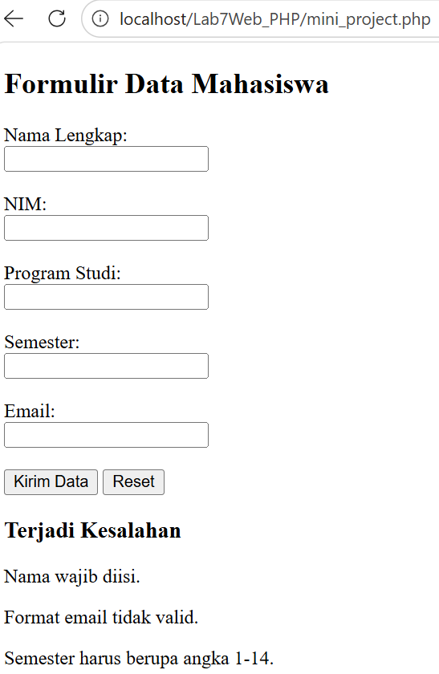

**Hasil Pengujian Data Valid**

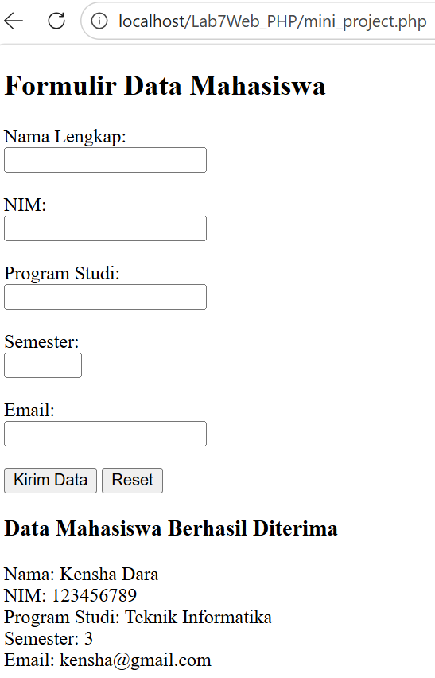

### C. Eksperimen Mandiri

**Eksperimen 1 – Menghitung Nilai Rata-Rata**

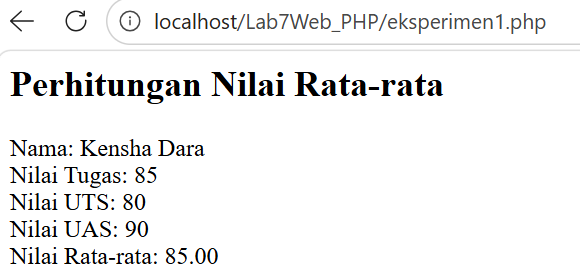

**Eksperimen 2 – Pencarian Menggunakan GET**

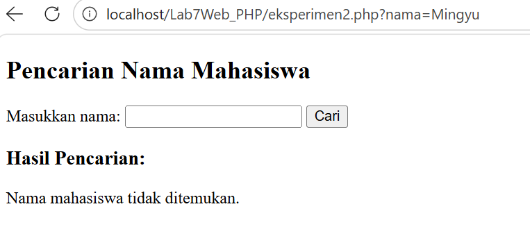

**Eksperimen 3 – Format Rupiah**

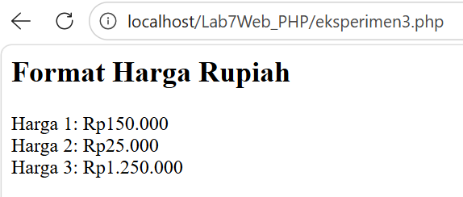

**Eksperimen 4 – Validasi NIM Tidak Valid**

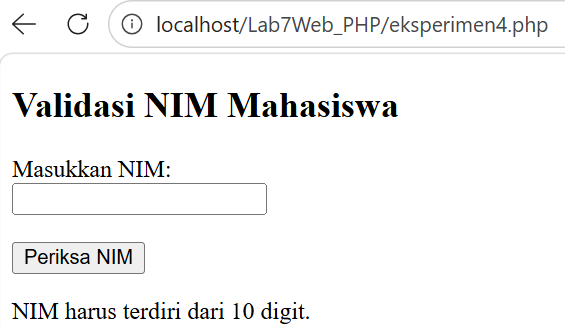

**Eksperimen 4 – Validasi NIM Valid**

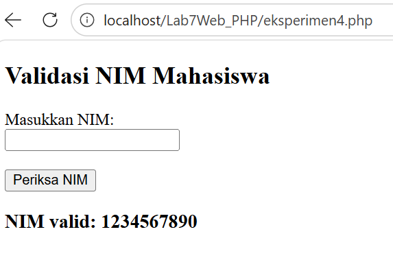

**Eksperimen 5 – Hasil Kirim Data**

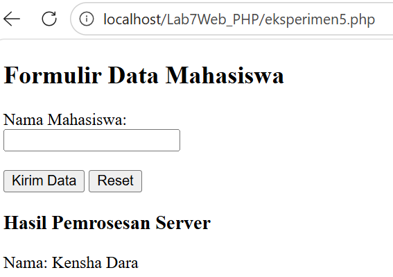

**Eksperimen 5 – Hasil Reset Form**

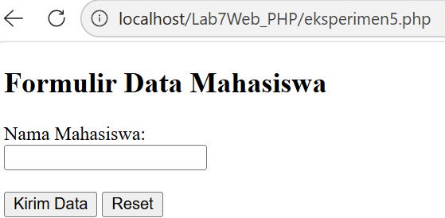

Seluruh dokumentasi screenshot disimpan dalam folder `screenshots` pada direktori proyek `Lab7Web_PHP`.

## 9. Pertanyaan Evaluasi

**1. Apa perbedaan pemrosesan client-side dan server-side?**

Client-side adalah proses yang dijalankan di sisi browser pengguna, seperti HTML, CSS, dan JavaScript. Sedangkan server-side adalah proses yang dijalankan di server untuk menerima permintaan, mengolah data, dan mengirimkan hasil kembali ke browser. PHP merupakan salah satu bahasa pemrograman server-side.

**2. Mengapa file PHP harus dijalankan melalui web server?**

Karena PHP merupakan bahasa pemrograman server-side yang membutuhkan web server untuk menjalankan dan memproses kode PHP. Hasil pemrosesan kemudian dikirimkan ke browser dalam bentuk HTML.

**3. Apa fungsi tanda $ pada variabel PHP?**

Tanda `$` digunakan sebagai penanda variabel dalam PHP. Variabel berfungsi untuk menyimpan data yang dapat digunakan dan diolah dalam program.

Contoh:

```php
$nama = "Kensha Dara";
$umur = 23;
```

**4. Apa perbedaan metode GET dan POST?**

GET mengirimkan data melalui parameter URL sehingga data terlihat pada alamat browser. Sedangkan POST mengirimkan data melalui body permintaan sehingga data tidak ditampilkan pada URL dan biasanya digunakan untuk mengirimkan data formulir.

**5. Mengapa input pengguna perlu divalidasi di sisi server?**

Validasi server diperlukan untuk memastikan data yang diterima sesuai dengan ketentuan program, mencegah kesalahan input, dan mengurangi risiko keamanan meskipun form sudah memiliki validasi HTML.

**6. Apa fungsi htmlspecialchars() ketika menampilkan data dari form?**

`htmlspecialchars()` berfungsi mengubah karakter khusus HTML menjadi bentuk yang aman ketika ditampilkan. Tujuannya untuk mengurangi risiko penyisipan kode HTML atau JavaScript berbahaya (XSS).

**7. Apa manfaat penggunaan function dalam program PHP?**

Function bermanfaat untuk mengelompokkan kode berdasarkan tugas tertentu, mengurangi pengulangan kode, membuat program lebih terstruktur, serta memudahkan penggunaan kembali kode.

## 10. Kesimpulan

Berdasarkan kegiatan Praktikum 7, dapat disimpulkan bahwa PHP merupakan bahasa pemrograman server-side yang dapat digunakan untuk mengolah data dan membuat aplikasi web dinamis.

Melalui praktikum ini, mahasiswa dapat memahami penggunaan variabel, operator, percabangan, perulangan, array, function, metode GET dan POST, serta validasi input.

Mini Project dan eksperimen mandiri memberikan pengalaman dalam membangun aplikasi sederhana menggunakan PHP dan menguji hasil pemrosesan data melalui web server lokal.